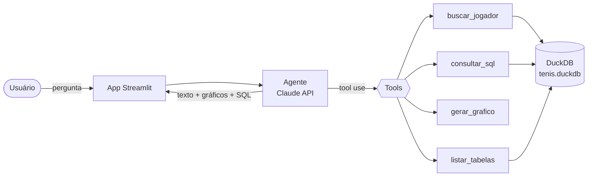

# 🎾 Scout de Tênis IA

**Pergunte sobre tênis em português e receba a resposta com números, tabelas e gráficos, calculados com SQL em dados reais da ATP.**


---

## O problema e a solução

**Problema:** estatísticas de tênis estão espalhadas em sites e planilhas. Perguntas simples, como "qual o H2H entre Sinner e Alcaraz no saibro?", exigem cruzar dezenas de partidas à mão.

**Solução:** um agente de IA que entende a pergunta, encontra os jogadores, escreve e executa a consulta SQL num banco com 79 mil partidas da ATP e responde com o número, o contexto e um gráfico. Ele também mostra o SQL que usou, para quem quiser conferir.

## Exemplos de perguntas

| Pergunta | Resposta (dados até 25/05/2026) |
|---|---|
| Qual o H2H entre Sinner e Alcaraz por superfície? | Sinner 7 × 10 Alcaraz (saibro 2–3, grama 2–0, quadra dura 3–7) |
| Quem mais venceu Grand Slams desde 2000? | Novak Djokovic, 24 títulos |
| Quantos aces o Isner fez em 2015? | 1.260 aces em 70 partidas |
| Qual o retrospecto do João Fonseca por superfície? | 54 vitórias em 88 partidas (61,4%) |

## Como funciona

O agente usa **tool use** da Claude API: em vez de responder de memória, o modelo decide quais ferramentas chamar, recebe os resultados e repete até ter a resposta.



Um exemplo do caminho que o agente faz:

1. **`buscar_jogador("Sinner")`** e **`buscar_jogador("Alcaraz")`**: transforma nomes em ids. A busca tolera acento e erro de digitação ("djokovich" encontra Djokovic).
2. **`consultar_sql(...)`**: conta as vitórias de cada um, agrupadas por superfície.
3. **`gerar_grafico(...)`**: monta um gráfico de barras Plotly.
4. Responde em português, cita a fonte e mostra os passos no painel **"🔍 Como cheguei nisso"**.


### As ferramentas do agente

| Tool | O que faz |
|---|---|
| `listar_tabelas()` | Mostra tabelas, views, colunas e tipos do banco |
| `buscar_jogador(nome)` | Busca aproximada (Jaro-Winkler, sem acento), top 5 candidatos com país e nº de partidas |
| `consultar_sql(sql)` | Executa uma consulta de leitura, com limite de 200 linhas e timeout de 20 s |
| `gerar_grafico(dados, tipo, x, y, titulo)` | Gráfico Plotly de barra, linha, dispersão ou radar |

### Segurança e confiabilidade

- **Só leitura:** o banco abre em modo `read_only`, sem acesso a arquivos externos nem rede. Antes de executar, cada SQL passa pelo parser do DuckDB e só `SELECT`/`WITH` são aceitos. `DROP`, `DELETE`, `COPY`, `ATTACH` e múltiplos comandos são bloqueados, e há testes para cada caso.
- **Autocorreção:** se a consulta falha, a mensagem de erro do banco volta para o modelo, que corrige e tenta de novo.
- **Sem números inventados:** o prompt de sistema exige que todo número venha de uma consulta feita na conversa e informa o período coberto pelos dados.
- **Limites:** no máximo 8 iterações por pergunta. Na última, as tools são desligadas para forçar uma resposta final.
- **Custo:** prompt caching em tools, prompt de sistema e histórico, para que as perguntas seguintes custem menos.

## Modo demonstração (sem chave da API)

Sem `ANTHROPIC_API_KEY`, o app abre em **modo demonstração**: as 6 perguntas de exemplo da barra lateral são respondidas por consultas prontas, que passam pelas mesmas tools e pelo mesmo banco, só que sem a IA. Assim dá para explorar a interface e os gráficos sem custo. Com a chave, o mesmo app passa a usar o agente e aceita qualquer pergunta.


## Os dados

- **Fonte:** [Jeff Sackmann / tennis_atp](https://github.com/JeffSackmann/tennis_atp). Como o repositório original saiu do GitHub, os CSVs vêm do fork [Kadantte/tennis_atp](https://github.com/Kadantte/tennis_atp), com os mesmos commits do autor.
- **Cobertura:** 79.299 partidas do circuito principal da ATP (03/01/2000 a 25/05/2026), 66.912 jogadores e 1,47 milhão de linhas de ranking semanal (2010 a 2026).
- **Fora do escopo:** Challengers, ITF e tênis feminino.

| Objeto | Tipo | Conteúdo |
|---|---|---|
| `partidas` | tabela | Uma linha por partida: vencedor, perdedor, placar, superfície, rodada, estatísticas de saque |
| `jogadores` | tabela | Nome, mão, data de nascimento, país, altura |
| `rankings` | tabela | Posição e pontos por semana |
| `partidas_jogador` | view | Uma linha **por jogador por partida**, do ponto de vista dele (`venceu`, `aces`, `adversario_id`...). Simplifica muito o SQL do agente. |

## Como rodar

Pré-requisito: Python 3.11 ou mais novo.

```bash
git clone https://github.com/diegookaique/scout-tenis-ia.git
cd scout-tenis-ia
python -m venv .venv
.venv\Scripts\activate          # Windows  (Linux/macOS: source .venv/bin/activate)
pip install -r requirements.txt
python scripts/carregar_dados.py   # baixa os CSVs e monta o tenis.duckdb (~1 min)
streamlit run app.py               # abre em http://localhost:8501
```

Para usar o agente com IA, copie `.env.example` para `.env` e preencha `ANTHROPIC_API_KEY`. Sem a chave, o app roda em modo demonstração.

| Comando | O que faz |
|---|---|
| `streamlit run app.py` | Interface web |
| `python -m src.agente` | Conversa com o agente no terminal (precisa da chave) |
| `pytest` | Roda os 46 testes (nenhum chama a API) |

## Estrutura do projeto

```
scout-tenis-ia/
├── app.py                  # interface Streamlit
├── scripts/
│   └── carregar_dados.py   # baixa os CSVs e monta o tenis.duckdb
├── src/
│   ├── db.py               # conexão read-only com o DuckDB
│   ├── tools.py            # as 4 tools e o TOOLS_SCHEMA da Anthropic API
│   ├── prompts.py          # prompt de sistema, glossário e exemplos few-shot
│   ├── agente.py           # loop de tool use (AgenteTenis) e modo terminal
│   └── demo.py             # modo demonstração sem API (AgenteDemo)
├── tests/                  # testes das tools, do agente (cliente falso) e do modo demo
├── docs/                   # imagens do README
├── ROTEIRO.md              # roteiro de desenvolvimento por etapas
└── requirements.txt
```

## Testes

46 testes com `pytest`, sem chamadas à API:

- **Tools:** busca de jogador com e sem acento e com erro de digitação, limite de linhas, datas serializáveis, todos os tipos de gráfico e bloqueio de escrita (`DROP`, `DELETE`, `INSERT`, `CREATE`, `COPY`, `ATTACH`, leitura de arquivos, múltiplos comandos).
- **Agente:** um cliente falso roteiriza as respostas do modelo para testar o loop, a autocorreção depois de um SQL com erro, o limite de iterações, o histórico e os parâmetros da requisição.
- **Modo demonstração:** cada pergunta de exemplo executa sem erro e com os valores esperados.

## Status e próximos passos

- [x] Carga dos dados no DuckDB
- [x] Tools do agente com testes
- [x] Agente com tool use, autocorreção e modo terminal
- [x] Interface Streamlit com modo demonstração
- [ ] Avaliação automática com perguntas de referência (meta: ≥ 80% de acerto)
- [ ] Diferencial: evolução no ranking, Elo por superfície ou cartão H2H
- [ ] Deploy no Streamlit Community Cloud

O detalhe de cada etapa está no [ROTEIRO.md](ROTEIRO.md).

## Stack

Python · DuckDB · Anthropic SDK (Claude, tool use) · Streamlit · Plotly · pandas · pytest

## Créditos e licença dos dados

Dados de tênis de **Jeff Sackmann / [tennis_atp](https://github.com/JeffSackmann/tennis_atp)**, sob licença [CC BY-NC-SA 4.0](https://creativecommons.org/licenses/by-nc-sa/4.0/). Uso não comercial, com atribuição.

---

## English summary

**Tennis Scout AI** answers questions about men's professional tennis (ATP) in natural language. A Claude agent uses tool use to look up players, write and run read-only SQL against a DuckDB database of 79k ATP matches (2000–2026), and return the answer with Plotly charts and the exact SQL it ran. The SQL is restricted to `SELECT`/`WITH` on a read-only connection, failed queries are fed back to the model for self-correction, and 46 tests cover the tools, the agent loop (with a fake client) and a no-API demo mode. Built with Python, DuckDB, the Anthropic SDK, Streamlit and Plotly. Data by Jeff Sackmann (CC BY-NC-SA 4.0).
