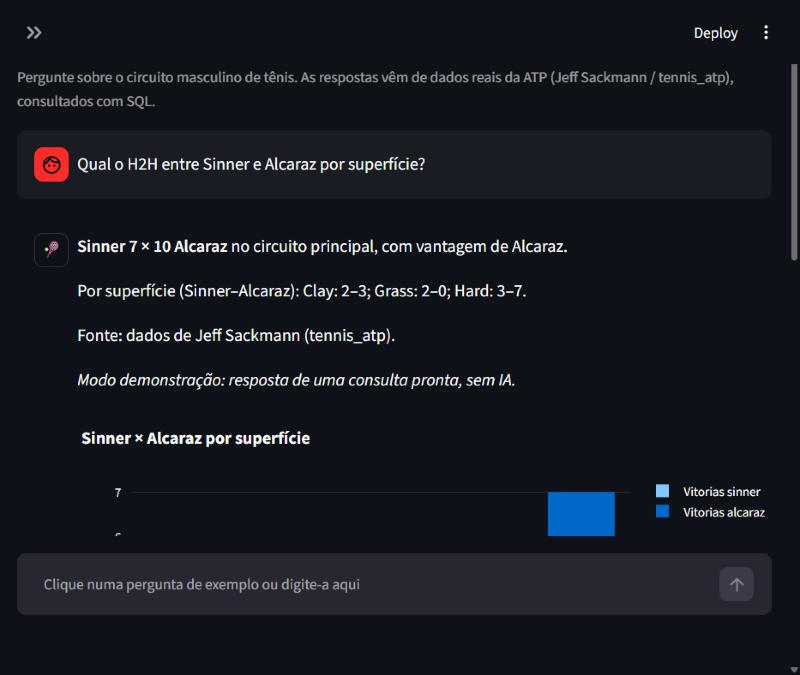
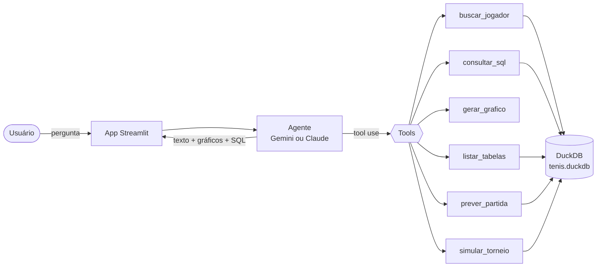
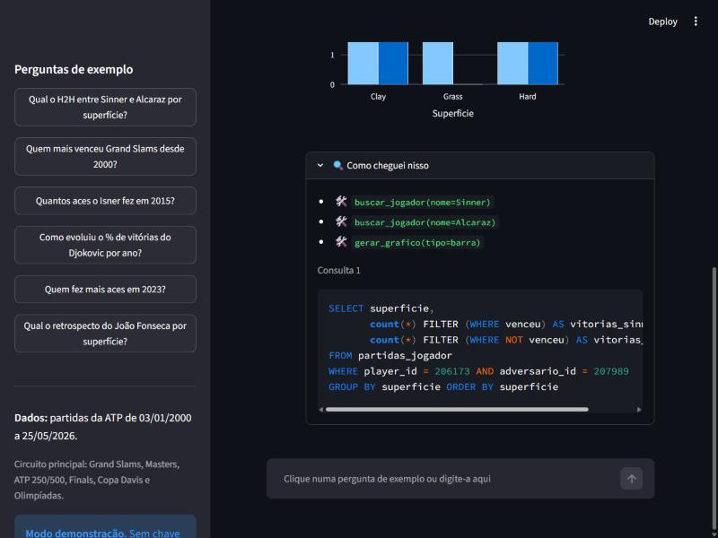
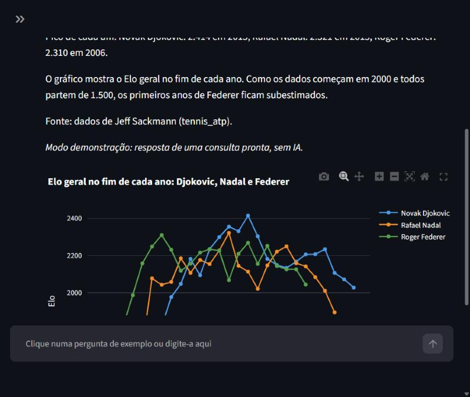
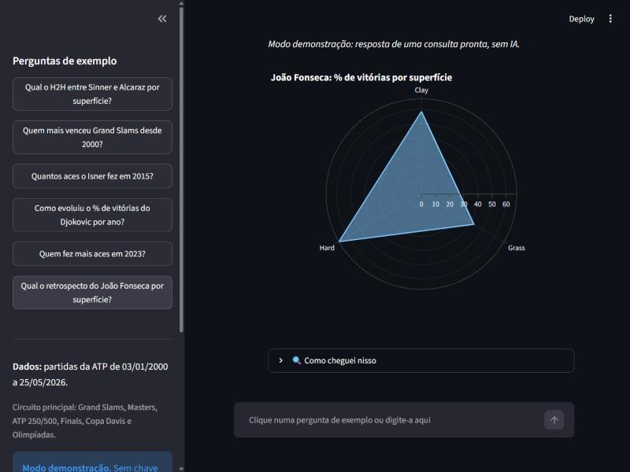

# 🎾 Scout de Tênis IA

**Pergunte sobre tênis em português e receba a resposta com números, tabelas e gráficos, calculados com SQL em dados reais da ATP.**




---

## O problema e a solução

**Problema:** estatísticas de tênis estão espalhadas em sites e planilhas. Perguntas simples, como "qual o H2H entre Sinner e Alcaraz no saibro?", exigem cruzar dezenas de partidas à mão.

**Solução:** um agente de IA que entende a pergunta, encontra os jogadores, escreve e executa a consulta SQL num banco com 79 mil partidas da ATP e responde com o número, o contexto e um gráfico. Ele também mostra o SQL que usou, para quem quiser conferir.

## Exemplos de perguntas

As 10 perguntas da tela inicial, em duas colunas:

| Previsões 2026 | Resposta | Temporada em números | Resposta |
|---|---|---|---|
| Quem vai ganhar o ATP Finals de 2026? | Sinner, 55,8% (20 mil simulações) | Quem tem o melhor aproveitamento em 2026? | Sinner, 92,5% (37–3) |
| Quem vai terminar 2026 como número 1? | Sinner: lidera pontos, aproveitamento, títulos e Elo | Quem fez mais aces em 2026? | Taylor Fritz, 324 |
| Quem é o favorito para Wimbledon 2026? | Sinner e Alcaraz, quase empatados no Elo de grama | Sinner × Alcaraz: como está o confronto direto? | Alcaraz 10 × 7 |
| Sinner × Alcaraz no saibro: quem é favorito? | Sinner, 52,2% | Como o João Fonseca evoluiu no ranking? | Do 730º (jan/2024) ao 25º, melhor posição 24º |
| Quem são as revelações de 2026? | Rafael Jodar, +281 de Elo | Como evoluiu o Elo de Sinner, Alcaraz e Djokovic? | Sinner lidera em 2026 (2.282) |

Dados até 25/05/2026 (ranking até 08/06/2026). Previsões são estimativas do modelo Elo, não certezas.

## Como funciona

O agente usa **tool use** (no Gemini, *function calling*): em vez de responder de memória, o modelo decide quais ferramentas chamar, recebe os resultados e repete até ter a resposta.

O agente funciona com **dois provedores de IA**, com as mesmas tools, o mesmo prompt e a mesma trava de SQL:

| Provedor | Variável | Custo | Arquivo |
|---|---|---|---|
| **Gemini API (Google)**, modelo `gemini-flash-lite-latest` | `GEMINI_API_KEY` | plano gratuito, sem cartão | `src/agente_gemini.py` |
| **Claude API (Anthropic)**, modelo `claude-sonnet-5-5` | `ANTHROPIC_API_KEY` | pago por uso | `src/agente.py` |

O app escolhe sozinho pela chave que existir (o Gemini tem prioridade; `PROVEDOR=claude` força o outro). As tools são definidas uma vez só, no formato da Anthropic, e convertidas para as declarações de função do Gemini.



Um exemplo do caminho que o agente faz:

1. **`buscar_jogador("Sinner")`** e **`buscar_jogador("Alcaraz")`**: transforma nomes em ids. A busca tolera acento e erro de digitação ("djokovich" encontra Djokovic).
2. **`consultar_sql(...)`**: conta as vitórias de cada um, agrupadas por superfície.
3. **`gerar_grafico(...)`**: monta um gráfico de barras Plotly.
4. Responde em português, cita a fonte e mostra os passos no painel **"🔍 Como cheguei nisso"**.



### As ferramentas do agente

| Tool | O que faz |
|---|---|
| `listar_tabelas()` | Mostra tabelas, views, colunas e tipos do banco |
| `buscar_jogador(nome)` | Busca aproximada (Jaro-Winkler, sem acento), top 5 candidatos com país e nº de partidas |
| `consultar_sql(sql)` | Executa uma consulta de leitura, com limite de 200 linhas e timeout de 20 s |
| `gerar_grafico(dados, tipo, x, y, titulo)` | Gráfico Plotly de barra, linha, dispersão ou radar |
| `prever_partida(jogador_a_id, jogador_b_id, superficie)` | Chance de vitória de cada jogador pelo Elo, com avisos de confiabilidade |
| `simular_torneio(jogadores_ids, superficie)` | Simula o torneio 20 mil vezes (Monte Carlo) e dá a chance de semifinal, final e título de cada um. Com 8 jogadores, usa o formato do ATP Finals (2 grupos de 4, semifinais cruzadas e final) |

### Segurança e confiabilidade

- **Só leitura:** o banco abre em modo `read_only`, sem acesso a arquivos externos nem rede. Antes de executar, cada SQL passa pelo parser do DuckDB e só `SELECT`/`WITH` são aceitos. `DROP`, `DELETE`, `COPY`, `ATTACH` e múltiplos comandos são bloqueados, e há testes para cada caso.
- **Autocorreção:** se a consulta falha, a mensagem de erro do banco volta para o modelo, que corrige e tenta de novo.
- **Sem números inventados:** o prompt de sistema exige que todo número venha de uma consulta feita na conversa e informa o período coberto pelos dados.
- **Limites:** no máximo 8 iterações por pergunta. Na última, as tools são desligadas para forçar uma resposta final.
- **Custo:** prompt caching em tools, prompt de sistema e histórico, para que as perguntas seguintes custem menos.

## Avaliação do agente

O agente foi avaliado em 13 perguntas de referência com o **Gemini Flash-Lite (plano gratuito)**:

| Resultado | SQL com erro | Passos por pergunta | Tempo por pergunta |
|---|---|---|---|
| **13 de 13 certas (100%)**, meta de 80% | 0 | 1 a 5 | 4 a 18 s |

As perguntas cobrem confronto direto, títulos, recorde por superfície, estatística de saque, evolução no tempo, ranking, comparação, jogador brasileiro, previsão por Elo, uma pergunta ambígua (há dois Zverev em 2017) e duas fora da base (WTA e um ano antes de 2000, em que o certo é dizer que não há dado).

- **Resposta certa vem do banco:** cada pergunta em [`tests/perguntas_teste.yaml`](tests/perguntas_teste.yaml) tem um SQL de referência, executado na hora da avaliação. O script procura esses valores no texto do agente, nos formatos "1.260" e "79,8%".
- **Relatório completo:** [`avaliacao.md`](avaliacao.md) tem a tabela e todas as respostas do agente. Para repetir: `python scripts/avaliar.py`.
- **O que a avaliação mudou no prompt:** lendo as respostas da primeira rodada, os números estavam certos, mas o agente acrescentava contexto de memória (uma vez errado), fazia média de percentuais por partida em vez de somar pontos e respondia "0 títulos" para um ano fora da base. Três regras novas no prompt corrigiram isso.
- **Limite conhecido:** a correção automática confere os números e nomes principais, não cada frase do contexto. Por isso as respostas foram lidas também à mão. Ainda aparece, às vezes, um fato de memória verdadeiro (ex.: as 310 semanas do Federer como nº 1 na carreira).

## Previsão de partidas com Elo por superfície

O projeto calcula um **rating Elo** para cada jogador, percorrendo as 78.829 partidas jogadas desde 2000 em ordem cronológica (walkovers ficam de fora). Cada jogador tem um **Elo geral** e um **Elo por superfície** (quadra dura, saibro, grama e carpete). Todo jogador começa com 1.500. Quem vence ganha pontos, e ganha mais quando vence um adversário mais forte.

A previsão usa a **média do Elo geral com o da superfície**. O Elo da superfície capta a especialidade do jogador, mas sozinho tem poucas partidas: na grama são poucas semanas por ano, e os ratings ficam "comprimidos" perto de 1.500. O geral tem muitas partidas, mas ignora a superfície. A média junta as duas coisas.

### Evolução no tempo

Como o Elo é guardado depois de cada partida, dá para ver a trajetória de qualquer jogador. Abaixo, o Elo geral de fim de ano do Big 3: o auge de Federer em 2006, a alternância entre 2008 e 2013 e o pico de Djokovic em 2015 (2.414, o maior dos três).



### Validação

Para escolher o modelo, cada partida desde 2023 foi prevista **só com os ratings de antes dela** (10.329 partidas), e as variações foram comparadas:

| Modelo | Acerto do favorito | Brier score ↓ | Log loss ↓ |
|---|---|---|---|
| Ranking ATP: o mais bem ranqueado vence (referência) | 63,9% | – | – |
| Elo só da superfície, K = 32 | 63,0% | 0,224 | 0,639 |
| Elo geral, K = 32 | 64,1% | 0,221 | 0,632 |
| Elo combinado, K dinâmico (fórmula do FiveThirtyEight) | 63,9% | 0,222 | 0,636 |
| **Elo combinado, K = 32 (escolhido)** | **64,2%** | **0,219** | **0,628** |

O Elo acerta o vencedor tanto quanto o ranking ATP, mas entrega uma **probabilidade calibrada** em vez de só uma ordem, e é isso que o Brier score e o log loss medem. O K dinâmico, que desacelera o ajuste para veteranos, não melhorou o resultado. Por isso ficou o K = 32 clássico. Os números são recalculados e gravados na tabela `elo_validacao` sempre que os dados são carregados.

**Limites:** o Elo vem só de resultados. Ele não vê lesões, partidas fora do circuito principal (Challengers) nem estilo de jogo. Por isso a tool devolve avisos junto com a previsão, por exemplo quando um jogador tem menos de 20 partidas na superfície.

## Modo demonstração (sem chave da API)

Sem nenhuma chave de IA, o app abre em **modo demonstração**: as 10 perguntas de exemplo (na tela inicial e na barra lateral) são respondidas por consultas prontas, que passam pelas mesmas tools e pelo mesmo banco, só que sem a IA. Assim dá para explorar a interface e os gráficos sem custo. Com a chave, o mesmo app passa a usar o agente e aceita qualquer pergunta. Se a IA estiver indisponível (por exemplo, no limite do plano gratuito), as perguntas de exemplo continuam respondendo com essas consultas prontas.



## Os dados

- **Fonte:** [Jeff Sackmann / tennis_atp](https://github.com/JeffSackmann/tennis_atp). Como o repositório original saiu do GitHub, os CSVs vêm do fork [Kadantte/tennis_atp](https://github.com/Kadantte/tennis_atp), com os mesmos commits do autor.
- **Cobertura:** 79.299 partidas do circuito principal da ATP (03/01/2000 a 25/05/2026), 66.912 jogadores e 1,47 milhão de linhas de ranking semanal (2010 a 2026).
- **Fora do escopo:** Challengers, ITF e tênis feminino.

| Objeto | Tipo | Conteúdo |
|---|---|---|
| `partidas` | tabela | Uma linha por partida: vencedor, perdedor, placar, superfície, rodada, estatísticas de saque |
| `jogadores` | tabela | Nome, mão, data de nascimento, país, altura |
| `rankings` | tabela | Posição e pontos por semana |
| `elo` | tabela | Rating Elo de cada jogador depois de cada partida, geral e por superfície |
| `elo_atual` | tabela | Último Elo de cada jogador em cada superfície |
| `elo_validacao` | tabela | Acerto, Brier e log loss de cada variação do modelo |
| `partidas_jogador` | view | Uma linha **por jogador por partida**, do ponto de vista dele (`venceu`, `aces`, `adversario_id`...). Simplifica muito o SQL do agente. |

## Como rodar

Pré-requisito: Python 3.11 ou mais novo.

```bash
git clone https://github.com/diegookaique/scout-tenis-ia.git
cd scout-tenis-ia
python -m venv .venv
.venv\Scripts\activate          # Windows  (Linux/macOS: source .venv/bin/activate)
pip install -r requirements.txt
python scripts/carregar_dados.py   # baixa os CSVs, monta o tenis.duckdb e calcula o Elo (~1 min)
streamlit run app.py               # abre em http://localhost:8501
```

Para usar o agente com IA sem custo, gere uma chave gratuita em [aistudio.google.com/apikey](https://aistudio.google.com/apikey) (login com a conta Google, sem cartão), copie `.env.example` para `.env` e preencha `GEMINI_API_KEY`. Quem tiver crédito na Anthropic pode preencher `ANTHROPIC_API_KEY`. Sem chave, o app roda em modo demonstração.

No plano gratuito do Gemini há limite de pedidos por minuto e por dia. Se passar dele, o app avisa para esperar um pouco; nada é cobrado.

**Publicar na internet (grátis):** o app está pronto para o Streamlit Community Cloud. No servidor, o banco é montado sozinho na primeira visita (cerca de 1 a 2 minutos). O passo a passo está em [DEPLOY.md](DEPLOY.md).

| Comando | O que faz |
|---|---|
| `streamlit run app.py` | Interface web |
| `python -m src.agente` | Conversa com o agente no terminal (precisa da chave) |
| `python scripts/calcular_elo.py` | Recalcula só o Elo e imprime a validação |
| `python scripts/avaliar.py` | Avalia o agente nas 13 perguntas de referência e gera `avaliacao.md` (precisa da chave) |
| `pytest` | Roda os 122 testes (nenhum chama a API) |

## Estrutura do projeto

```
scout-tenis-ia/
├── app.py                  # interface Streamlit
├── assets/estilo.css       # visual do app (tema de tênis, claro e escuro)
├── scripts/
│   ├── carregar_dados.py   # baixa os CSVs e monta o tenis.duckdb
│   ├── calcular_elo.py     # Elo histórico por superfície e validação
│   └── avaliar.py          # avaliação do agente nas perguntas de referência
├── src/
│   ├── db.py               # conexão read-only com o DuckDB
│   ├── elo.py              # matemática do Elo, previsão, métricas e simulação de torneio
│   ├── tools.py            # as 6 tools e o TOOLS_SCHEMA (formato Anthropic, convertido p/ Gemini)
│   ├── prompts.py          # prompt de sistema, glossário e exemplos few-shot
│   ├── agente.py           # loop de tool use com a Claude API (AgenteTenis) e modo terminal
│   ├── agente_gemini.py    # o mesmo loop com a Gemini API (AgenteGemini)
│   ├── provedores.py       # escolhe Gemini, Claude ou modo demo pelas chaves
│   ├── preparo.py          # monta o banco na primeira execução (deploy)
│   ├── avaliacao.py        # perguntas de referência e correção automática
│   └── demo.py             # modo demonstração sem API (AgenteDemo)
├── tests/                  # testes + perguntas_teste.yaml (perguntas de referência)
├── avaliacao.md            # último relatório da avaliação
├── docs/                   # imagens do README
├── DEPLOY.md               # passo a passo da publicação no Streamlit Community Cloud
├── ROTEIRO.md              # roteiro de desenvolvimento por etapas
└── requirements.txt
```

## Testes

122 testes com `pytest`, sem chamadas à API:

- **Elo:** probabilidades da fórmula, conservação dos pontos com K fixo, previsão usando só partidas anteriores, métricas (acerto, Brier) e simulação de torneio (chances somam 100%, favorito ganha mais, resultado reproduzível).
- **Tools:** previsão simétrica e com probabilidades somando 100%, avisos de poucas partidas, busca de jogador com e sem acento e com erro de digitação, limite de linhas, datas serializáveis, todos os tipos de gráfico e bloqueio de escrita (`DROP`, `DELETE`, `INSERT`, `CREATE`, `COPY`, `ATTACH`, leitura de arquivos, múltiplos comandos).
- **Agentes (Claude e Gemini):** um cliente falso roteiriza as respostas do modelo para testar o loop, a autocorreção depois de um SQL com erro, o limite de iterações, o histórico e os parâmetros da requisição.
- **Provedores:** escolha do provedor pelas chaves e mensagens claras para chave recusada e limite gratuito atingido.
- **Modo demonstração:** cada pergunta de exemplo executa sem erro e com os valores esperados.
- **Avaliação:** leitura de números nos formatos brasileiro e americano, tolerância, pergunta ambígua, recusa e validade do SQL de referência de cada pergunta.

## Status e próximos passos

- [x] Carga dos dados no DuckDB
- [x] Tools do agente com testes
- [x] Agente com tool use, autocorreção e modo terminal
- [x] Interface Streamlit com modo demonstração
- [x] Avaliação automática com perguntas de referência: 13/13 (meta: ≥ 80%)
- [x] Elo por superfície com previsão de partidas e validação
- [x] Gráfico da evolução do Elo ao longo dos anos
- [ ] Deploy no Streamlit Community Cloud (código pronto; passo a passo em [DEPLOY.md](DEPLOY.md))

O detalhe de cada etapa está no [ROTEIRO.md](ROTEIRO.md).

## Stack

Python · DuckDB · Google Gen AI SDK (Gemini) · Anthropic SDK (Claude) · Streamlit · Plotly · pandas · pytest

## Créditos e licença dos dados

Dados de tênis de **Jeff Sackmann / [tennis_atp](https://github.com/JeffSackmann/tennis_atp)**, sob licença [CC BY-NC-SA 4.0](https://creativecommons.org/licenses/by-nc-sa/4.0/). Uso não comercial, com atribuição.

---

## English summary

**Tennis Scout AI** answers questions about men's professional tennis (ATP) in natural language. An LLM agent (Google Gemini on the free tier, or Anthropic Claude) uses tool use to look up players, write and run read-only SQL against a DuckDB database of 79k ATP matches (2000–2026), and return the answer with Plotly charts and the exact SQL it ran. It also predicts matches and simulates tournaments (Monte Carlo of the ATP Finals format) with a surface-blended Elo rating, validated on 10k matches since 2023 (64.2% accuracy, Brier 0.219, vs. 63.9% for "higher ATP rank wins"). The SQL is restricted to `SELECT`/`WITH` on a read-only connection, failed queries are fed back to the model for self-correction, and 122 tests cover the Elo model, the tools, both agent loops (with fake clients) and a no-API demo mode. On 13 reference questions whose answers are computed by SQL at evaluation time, the agent on Gemini Flash-Lite (free tier) scored 13/13, with zero failed queries. Built with Python, DuckDB, the Google Gen AI and Anthropic SDKs, Streamlit and Plotly. Data by Jeff Sackmann (CC BY-NC-SA 4.0).
